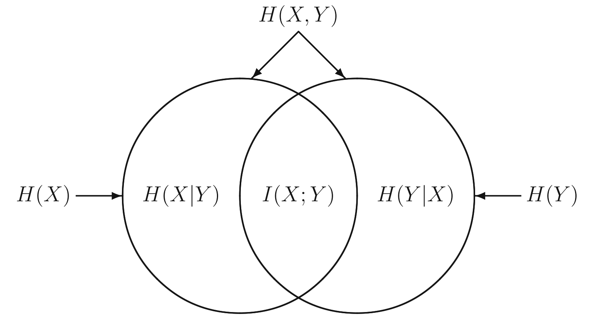
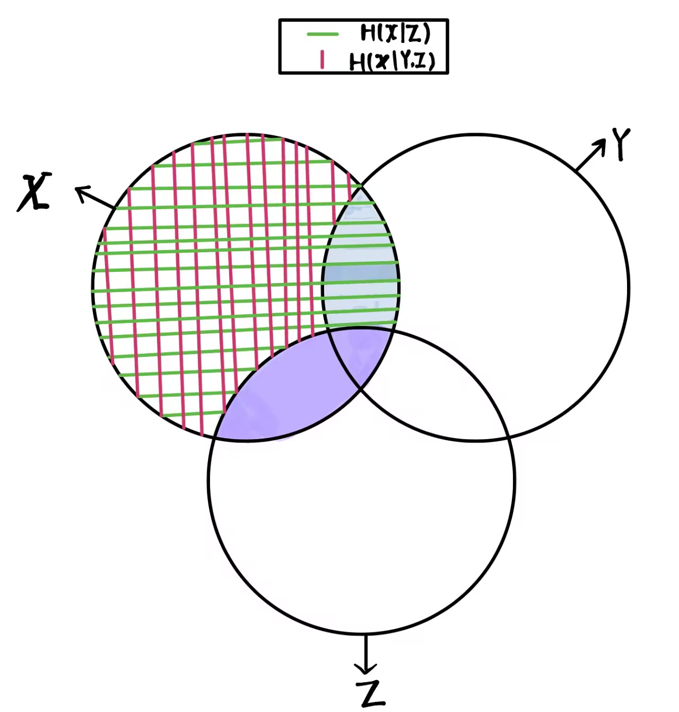

# ※  Self-Information $I(n)$

我们要定义一个函数(或者说一个事件新的属性，称为自信息)，该函数能够衡量当一件事情在发生之前事件的不确定性，如此我们首先达成以下共识：

1. 事件需要依据它的固有属性数字化，这里我们使用事件发生的概率
2. 当一个事件发生的概率越大，所含信息量越少，概率为1时候，信息量为0。
3. 独立事件同时发生时候，信息量是各个独立事件信息量之和
4. 事件发生概率的微小变动会影响自信息

注意，这里的信息量是一种信息容量，就像kg一样刻画物体的质量，但是不同的是，信息容量表示的内在含义是指数级的，如3bit相对于1bit，数字上是3倍，但是3bit可以刻画的状态数却是四倍于1bit。我们可以粗浅理解这里的信息量类似于比特数，它是一种新的量纲!

## 1  数学描述

### Cond1

设事件 $E$ 属于一个给定的事件集合(空间)，其发生概率为:

$$
\begin{aligned} P_{e}:= Pr(E) \\ 0\le P_{e}\le 1 \end{aligned}
$$

因此我们要找一个实函数，其性质如下:

$$
I(x),\quad x\in [0,1]
$$

### Cond2

该函数是一个单调递减函数：

$$
\forall x_{i},x_{j}\in [0,1],\quad \text{if } x_{i}<x_{j}\quad \text{then } I(x_{j})<I(x_{i}) \tag{1-1}
$$

并且有一个固定点：

$$
I(1) = 0
$$

### Cond3

独立事件同时发生的概率等于各个事件发生概率之积，因此函数具有以下性质：

$$
I(p_{1}\times p_{2}) = I(p_{1})+I(p_{2}) \tag{1-2}
$$

### Cond4

$I(x)$是一个连续的函数

## 2  数学证明

### 2.1  提出命题

满足上述四个条件的函数只能是：

$$
I(p) = -c\cdot log_{b}(p),\quad p\in (0,1] \tag{2-1}
$$

其中c是一个正实数，b是一个任何大于1的整数。

### 2.2  证明过程

#### 2.2.1  引理-1

先证明如下引理：对于$n=1,2,3,..$

$$
I(\frac{1}{n}) = -c\cdot log_{b}(\frac{1}{n}) \tag{2-2}
$$

**证明：**

当n=1时，根据Cond2，$左=I(1)=0$，$右=-c \cdot log_b(1)=0=左$，等式成立。

当n>1时，依据公式1-1以及公式1-2，知道当n<m时，

$$
\begin{aligned} \frac{1}{m}<\frac{1}{n} \implies I(\frac{1}{n})<I(\frac{1}{m}) \\ I(\frac{1}{mn}) = I(\frac{1}{m})+I(\frac{1}{n}) \end{aligned}
$$

同时，依据公式1-2，不难推导出对于任意非负整数k，有：

$$
I(\frac{1}{n^{k}}) = k\cdot I(\frac{1}{n}) \tag{2-3}
$$

对于任意正整数r，一定有非负整数k：

$$
n^{k}\le 2^{r}<n^{k+1}
$$

根据公式1-1和公式2-3以及$r>0$且$n>1,I(\frac{1}{n})>0$：

$$
\begin{aligned}
 \begin{aligned} I(\frac{1}{n^{k}})\le I(\frac{1}{2^{r}})<I(\frac{1}{n^{k+1}}) \implies k\cdot I(\frac{1}{n})\le r\cdot I(\frac{1}{2})<(k+1)\cdot I(\frac{1}{n}) \\ \implies \frac{k}{r}\le \frac{I(\frac{1}{2})}{I(\frac{1}{n})}<\frac{k+1}{r}
\end{aligned} \tag{2-4} \end{aligned}
$$

易知：

$$
log_{b}n^{k}\le log_{b}2^{r}\le log_{b}n^{k+1}\\text{if } f \frac{k}{r}\le \frac{log_{b}(2)}{log_{b}(n)}\le \frac{k+1}{r} \tag{2-5}
$$

综合公式2-4和公式2-5有：

$$
|\frac{log_{b}(2)}{log_{b}(n)}-\frac{I(1/2)}{I(1/n)}|<\frac{1}{r}
$$

因为b也是常量，当n固定时候，$r \to \infty$，可以知道：

$$
I(\frac{1}{n}) = -c\cdot log_{b}(n), c = \frac{I(1/2)}{log_{b}(2)}>0
$$

引理-1得证。

#### 2.2.2  引理-2

再证明如下引理：对于正有理数$0<p<1$，有：

$$
I(p) = -c\cdot log_{b}(p)
$$

其中$c>0$是一个常数。

**证明：**因为p是一个正有理数，所以一定存在正整数r,s使得$p=r/s$。

由公式1-2知：

$$
\begin{aligned} I(\frac{1}{s}) = I(\frac{1}{r}\cdot \frac{r}{s}) = I(\frac{1}{r})+I(\frac{r}{s}) \\ \implies I(\frac{r}{s}) = I(\frac{1}{s})-I(\frac{1}{r}) \end{aligned}
$$

根据中间引理-1知：

$$
I(p) = I(\frac{r}{s}) = I(\frac{1}{s})-I(\frac{1}{r}) = c\cdot log_{b}(s)-c\cdot log_{b}(r) = -c\cdot log_{b}(p)
$$

所以中间引理-2得证。

#### 2.2.3  引理-3

最后证明如下引理：

$$
I(p) = -c\cdot log_{b}(p), p\in (0,1]\text{函}\text{数}\text{连}\text{续}
$$

易知：

$$
I(p) = \lim _{a↓p a rational}I(a) = \lim _{b↑p b rational}I(b) = -c\cdot log_{b}(p)
$$

所以连续得证。

**综合上述3个引理，原命题得证。**

## 补充

我们通常将c设置为1，对于不同底数b，单位是不同的，b=2时，单位为bit，b=e也就是自然底数时，单位为nat

# ※  Entrophy

自信息讨论的是一整个事件空间中**某一个事件的属性**，这个属性只依赖于事件发生的概率。

可以这样理解：所谓自信息，香农提出的是概率性度量，香农认为，**记录一个概率发生小的事件比概率发生大的事件需要更多的空间，因为一个人确定低概率事件发生所需要的不确定性代价更高**。这符合直觉吗？联想一下哈夫曼编码，当我们给大概率事件赋予更少比特数时候，压缩率达到最高。

## 1  熵的定义

对于一个概率质量函数为$P_X(\cdot )$离散随机变量$X$，它的熵定义为：$H(X)$或者$H(P_x)$：

$$
H(X):= -\sum _{x\in \mathcal{X}}P_{X}(x)\cdot log_{2}P_{X}(x) (bits) \tag{1-1}
$$

其中$\mathcal{X}$是随机变量$X$取值的有限大小的字母集合，熵的含义是：当了解到字母集合中**一个**字母出现时候，一个人能够获得信息量的的**统计均值**。

$$
H(X):= E[-log_{2}P_{X}(X)] = E(I(X))
$$

在计算熵的时候我们规定：

$$
0\cdot log_{2}0 = 0
$$

因为随着$x\rightarrow0^+$，$xlog_2x\rightarrow0$

特别的，对于一个服从$0-1$分布的随机变量$X$，如果$P_X(1)=p$，并且$P_X(0)=1-p，p\in [0,1]$是一个定值，那么：

$$
H(X) = -p\cdot log_{2}(p)-(1-p)\cdot log_{2}(1-p)
$$

## 2 熵的属性

### 2.1  Fundamental Inequality(FI)

对于任意$x>0，D>1$，下面的不等式：

$$
log_{D}(x)\le log_{D}(e)\cdot (x-1) \tag{2-1}
$$

成立，且等号当且仅当$x=1$时成立

令$y=\frac{1}{x}$代入上式，亦得：

$$
log_{D}(y)\ge log_{D}(e)\cdot (1-\frac{1}{y}) \tag{2-2}
$$

对于任意$y>0$成立，并且等号当且仅当$y=1$时成立。

### 2.2  Nonenegativity

$H(X) \ge 0$ 恒成立，且等号当且仅当X是确定性的时候成立。

### 2.3  Upper bound on entropy

如果随机变量$X$从一个有限字母集合$\mathcal{X}$中取值，那么无论随机变量$X$的概率分布如何，它的熵有一个上界：

$$
H(X)\le log_{2}|\mathcal{X}| \tag{2-3}
$$

其中$|\mathcal{X}|$表示字母集合$\mathcal{X}$的大小，等号当且仅当$X$服从**均匀分布**成立。这个上界还叫Hartley's function or entrophy

### 2.4  Log-sum inequlity

对于所有非负数，$a_1, a_2, ..., a_n$和$b_1, b_2, ..., b_n$，有不等式：

$$
\sum _{i = 1}^{n}(a_{i} log_{D}\frac{a_{i}}{b_{i}})\ge (\sum _{i = 1}^{n}a_{i}) log_{D} \frac{\sum _{i = 1}^{n}a_{i}}{\sum _{i = 1}^{n}b_{i}} \tag{2-4}
$$

等式当且仅当对于所有的$i=1, ..., n$，

$$
\frac{a_{i}}{b_{i}} = \frac{\sum _{j = 1}^{n}a_{j}}{\sum _{j = 1}^{n}b_{j}}
$$

证明可以使用著名的琴生不等式加权版(Jensen's inequality)。

#### 凸集

一个集合是凸集(convex set)，如果对任意$x_1,x_2\in C$和$\theta \in [0, 1]$ 都有：

$$
\theta x_{1}+(1-\theta )x_{2}\in C
$$

仿射集自然是凸集的一种，类比于仿射集的相关概念，我们可以得到**凸包**（*convex hull* ）的定义：

$$
\mathrm{conv}C = {\theta _{1}x_{1}+⋯+\theta _{k}x_{k}\mid x_{i}\in C,\theta _{i}\ge 0,i = 1,…,k,\theta _{1}+⋯+\theta _{k} = 1}
$$

#### 严格凸函数

$f:R^n \rightarrow R$如果定义域是凸集，有$\forall x,y, and \; when \; \theta \in [0,1]$有：

$$
f(\theta x+(1-\theta )y)\le \theta f(x)+(1-\theta )f(y) \tag{2-5}
$$

成立，且当$\theta \in (0,1)$且$x \ne y$时候，上述不等式不等号严格成立，则$f$称为严格凸函数。

#### 📌琴生不等式

对于任何严格凸函数(strictly convex function)$f(\cdot )$，如果$\alpha_i\ge0$并且$\sum_{i=1}^{n}{\alpha_i}=1$，则：

$$
\sum _{i = 1}^{n}\alpha f(t_{i})\ge f(\sum _{i = 1}^{n}\alpha _{i}t_{i}) \tag{2-6}
$$

成立，且等号当且仅当$t_1=t_2=...t_n=Const.num$

## 3  联合熵和条件熵

> **回顾**条件概率，这里千万**记住**：$P(X,Y|Z)$的含义是$P((X,Y)|Z)$也就是，在$Z$发生的条件下，$X,Y$一起发生的概率。同理，$P(Y|X,Z)$的含义是$P(Y|(X,Z))$也就是，在$X,Z$均发生的条件下 $Y$发生的概率。总之，**'$\; | \;$'**左右是一个整体，**'$，$'**的运算优先级**高于 '$\; | \;$'**

### 3.1  二维元素事件的自信息

一对随机变量$(X,Y)$，其联合概率质量函数为$P_{X,Y}(\cdot ,\cdot )$，则对于元事件$\left\{ X=x,Y=y \right\}$，其自信息为：

$$
\mathcal{I}(x,y):= -log_{2}P_{X,Y}(x,y) \tag{3-1}
$$

### 3.2  联合熵的定义

随机变量$(X,Y)$的熵定义为：

$$
H(X,Y):= -\sum _{(x,y)\in \mathcal{X}\times \mathcal{Y}}P_{X,Y}(x,y)\cdot log_{2}P_{X,Y}(x,y) \tag{3-2}
$$

### 3.3  条件熵的定义

给定两个联合分布的随机变量$X,Y$，考虑$X$对于$Y$的条件熵$H(Y|X)$定义为：

$$
\begin{aligned}
 \begin{aligned} H(Y|X) = E[-log_{2}P_{Y|X}(Y|X)] \\ = -\sum _{(x,y)\in \mathcal{X}\times \mathcal{Y}}P_{X,Y}(x,y)\cdot log_{2}P_{Y|X}(y|x) \\ = \sum _{x\in \mathcal{X}}P_{X}(x)(-\sum _{y\in \mathcal{Y}}P_{Y|X}(y|x)\cdot log_{2}P_{Y|X}(y|x)) \\ = \sum _{x\in \mathcal{X}}P_{X}(x)\cdot H(Y|X = x)
\end{aligned} \tag{3-3} \end{aligned}
$$

### 3.4  定理和推论

#### 熵的链式法则

$$
H(X,Y) = H(X)+H(Y|X)
$$

由联合熵的定义知：$H(X,Y)=H(Y,X)$，具有可交换性。所以：

$$
H(X,Y) = H(X)+H(Y|X) = H(Y)+H(X|Y) = H(Y,X) \tag{3-4}
$$

进一步有：

$$
H(X)-H(X|Y) = H(Y)-H(Y|X) \tag{3-5}
$$

上面等式中两边的含义就是后面会介绍的**互信息(mutual information)**！

#### 条件熵的链式法则

$$
H(X,Y|Z) = H(X|Z)+H(Y|X,Z) \tag{3-6}
$$

通俗理解，就是熵的链式法则的推广，只不过熵的链式法则是在全局事件空间$\Omega$下，

$$
H(X,Y) = H(X)+H(Y|X) \\text{if } f H(X,Y|Ω) = H(X|Ω)+H(Y|X,Ω)
$$

而条件熵则是在局部事件空间$Z$中。

## 4 联合熵和条件熵的属性

### 4.1  条件不增性 Conditioning never increases entrophy

引入条件后，事件空间不确定性不可能增加，可以认为产生了信息增益：

$$
H(X|Y)\le H(X) \tag{4-1}
$$

当且仅当$X,Y$独立时候取等。

### 4.2  独立可加性 Additivive for independent random variables

对于相互独立的随机变量$X,Y$，其联合熵可以表示为：

$$
H(X,Y) = H(X)+H(Y) \tag{4-2}
$$

### 4.3  条件不等式 Conditional entrophy is lower additive

$$
H(X_{1},X_{2}|Y_{1},Y_{2})\le H(X_{1}|Y_{1})+H(X_{2}|Y_{2}) \tag{4-3}
$$

# ※  Mutual Information

## 1  互信息的定义

通俗理解：对于两个随机变量$X$和$Y$，当观察到某一个随机变量时候，另一个随机变量不确定性减少的量。很显然，由定义容易推断其有对称性。事实上，它就隐藏在上一章熵的链式法则中：

$$
I(X; Y):= H(X)-H(X|Y) = H(Y)-H(Y|X) = I(Y; X) \tag{1-1}
$$

## 2  互信息的属性

### 2.1  互信息的等价表达式

$$
\begin{aligned}
 \begin{aligned} I(X; Y) = \sum _{x\in \mathcal{X}}\sum _{y\in \mathcal{Y}}P_{X,Y}(x,y)\cdot log_{2}\frac{P_{X,Y}(x,y)}{P_{X}(x)P_{Y}(y)} \\ = I(Y; X) = H(Y)-H(Y|X) \\ = H(X)+H(Y)-H(X,Y)
\end{aligned} \tag{2-1} \end{aligned}
$$

上述三个等式都可以根据熵的定义容易推出。

### 2.2  互信息不大于单随机变量的熵

$$
I(X; Y)\le H(X) \tag{2-2}
$$

等号当且仅当对于一些$X=f(Y)$情况成立。

### 2.3  互信息非负性

$$
I(X; Y)\ge 0, as H(X|Y)\le H(X) \tag{2-3}
$$

等号当且仅当$X和Y$相互独立。

### 2.4 互信息的上界

$$
I(X; Y)\le min{log_{2}|\mathcal{X}|, log_{2}|\mathcal{Y}|} \tag{2-4}
$$

这可以根据互信息的定义式以及熵的上界不等式推出。

熵，条件熵，联合熵，之间的Venn图关系如下：

## 3  条件互信息

> **注意：**在$I(\cdot )$中，关系运算符的优先级从高到低是  $, \;\;\;\; ; \;\;\;\; |$

### 3.1  定义

在获取了知识$Z$情况下，随机变量$X和Y$之间的共享不确定性。

$$
I(X; Y|Z) = H(X|Z)-H(X|Y,Z) \tag{3-1}
$$

### 3.2  联合互信息和互信息的链式法则

定义随机变量$X$和联合随机变量$(Y,Z)$联合互信息：

$$
I(X; Y,Z):= H(X)-H(X|Y,Z) \tag{3-2}
$$

我们有链式法则如下：

$$
I(X; Y,Z) = I(X; Y)+I(X; Z|Y) = I(X; Z)+I(X; Y|Z) \tag{3-3}
$$

使用Venn图理解就是：

其中上图图紫色实心区域为：$I(X;\; Z)$，蓝色实心区域为：$I(X;\; Y|Z)=H(X|Z)-H(X|Y,Z)$。而链式法则第二个等号右侧的含义就是 **紫色**实心区域 **+** **蓝色**实心区域 得到随机变量$X$与联合分布$(Y,Z)$之间的互信息：$I(X;\; Y,Z)$

# 参考链接🔗

[1. No.2 信息熵的广义可加性：条件熵、互信息的几何含义 - 知乎 (zhihu.com)](https://zhuanlan.zhihu.com/p/592345064)

[2. No.3 梳理汇总：信息熵、条件熵和互信息的性质及其推导 - 知乎 (zhihu.com)](https://zhuanlan.zhihu.com/p/592737528)

[3. 琴生不等式（Jensen's inequality)的证明 - 知乎 (zhihu.com)](https://zhuanlan.zhihu.com/p/560913131)

[4. Convex function - 知乎 (zhihu.com)](https://zhuanlan.zhihu.com/p/452821674)
