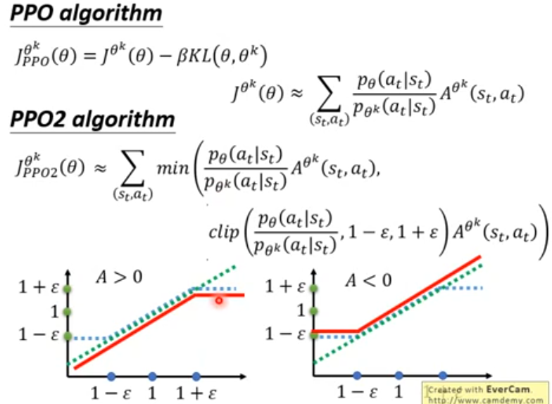

# DeepRL: From On-Policy to Off-Policy

## 1 Why Off-Policy ?

### 1.1 Definition

- On-policy: 需要学习的对象和环境交互的对象是同一个 (自己在亲身实践中学习)
- Off-policy: 需要学习的对象和环境交互的不是同一个 (看着别人学下棋)

On-policy存在的问题：第一种在策略梯度方法时候，需要每个训练周期分为两个阶段：

1. collect data
2. update model

### 1.2 策略梯度回顾

对于一个参数为$\theta$ 的执行者，策略梯度优化的目标是：

$$
\max \overline{\mathcal{R}}_{\theta } = \sum _{\tau }\mathcal{R}(\tau )\cdot p_{\theta }(\tau )
$$

即最大化执行者在所有可能轨迹上的总回报的期望。

我们要计算目标函数对参数$\theta$的梯度，暂时只考虑$p_{\theta}(\tau)$这一项和$\theta$有关，那么只需要考虑这一项的梯度。不难求出这一项的梯度展开如下

$$
\begin{aligned} p_{\theta }(\tau ) = p(s_{1})p(a_{1}|s_{1})p(s_{2}|s_{1},a_{1})⋯p(s_{T}) \\ \nabla p_{\theta }(\tau ) = p_{\theta }(\tau )\cdot \nabla \mathrm{log}⁡p_{\theta }(\tau ) \end{aligned}
$$

通过梯度公式，将函数连乘的梯度转换为函数和的梯度。这里我们进一步合理假设环境变化的概率和执行者的参数无关，那么$\nabla_{\theta} p(s_i|\cdot) = 0$。于是我们计算出这一项梯度为：

$$
\nabla p_{\theta }(\tau ) = p_{\theta }(\tau )\sum _{t = 1}^{T}\nabla _{\theta }\mathrm{log}⁡p(a_{t}|s_{t})
$$

所以目标函数的梯度可以写为：

$$
\begin{aligned} \nabla \overline{\mathcal{R}}_{\theta } = \sum _{\tau }p_{\theta }(\tau )\cdot \mathcal{R}(\tau )\sum _{t = 1}^{T}\nabla _{\theta }\mathrm{log}⁡p(a_{t}|s_{t}) \\ = \mathbb{E}_{\tau \sim p_{\theta }(\tau )}[\sum _{t = 1}^{T}\mathcal{R}(\tau )\cdot \nabla _{\theta }\mathrm{log}⁡p(a_{t}|s_{t})] \\ = \mathbb{E}_{(s_{t},a_{t})\sim \pi _{\theta }}[A(s_{t},a_{t})\cdot \nabla _{\theta }\mathrm{log}⁡p(a_{t}|s_{t})] \\ \approx \frac{1}{N}\sum _{i = 1}^{N}\sum _{t = 1}^{T_{i}-1}A(s_{t},a_{t})\nabla _{\theta }\mathrm{log}⁡p(a_{t}|s_{t}) \end{aligned}
$$

注意最后参数要向着目标函数值增大的方向更新，所以时加上梯度乘以学习率。最后使用了优势函数来替换每一个episode的总体回报。常见的优势函数设计如下：

$$
A(s_{t},a_{t}) = \sum _{t^{′} = t}\gamma ^{t^{′}-t}\cdot r_{t^{′}} ,\gamma <1
$$

### 1.2 策略梯度的问题

策略梯度作为一种on-policy方法，阶段一中需要收集大量的轨迹数据，也就是多组学习者和环境交互的轨迹。这是一个非常耗时的过程，但在训练周期中收集的数据只能被用来更新一次参数，下一个周期就要重新收集(因为轨迹和学习参数相关！)，这会导致训练的效率极低。

于是会自然的提出一个问题：我们是否可以从执行者参数无关的分布中采集数据？

重要性采样就是为了从一个新的分布中采样来替换旧的分布

## 2 Importance Sampling

对于一个分布$P(X)$，它的期望值可以这样计算：

$$
\begin{aligned} E_{x\sim p(x)}[f(x)] & = \int p(x)f(x) dx \\ & = \int q(x)\frac{p(x)}{q(x)}f(x) dx \\ & = E_{x\sim q(x)}[\frac{p(x)}{q(x)}f(x)] \end{aligned}
$$

不难发现，当从分布$q(X)$中采样，只要额外计算一个分式修正量(也称为重要性权重)即可。但是这里的分布$q(X)$并不是随便选择的，它需要至少符合下面的条件，才能保证期望的相等(无偏性)。

1. 支撑集覆盖(support coverage)：对于所有$p(x) > 0$的地方，都有$q(x)>0$。否则某些区域将无法采样到，也就没法准确计算期望     ps: 积分区域的完整性
2. 权重可计算且有限(Weight Computability and Finite Expectation)。

什么样的$q(x)$才算一个好的分布? 在无偏的背景下考虑方差，方差应该也要尽可能一致。

$$
\begin{aligned} Var_{x\sim p(x)}(f(x)) = E_{p}[f^{2}(x)]-E_{p}^{2}[f(x)] \\ Var_{x\sim q(x)}(\frac{p(x)}{q(x)}f(x)) = E_{p}[\frac{p(x)}{q(x)}f^{2}(x)]-E_{p}^{2}[f(x)] \end{aligned}
$$

所以，只有当$p(x)$和$q(x)$尽可能一致的时候(分布相似，有点像废话)方差的差距才会比较小。

## 3 Off-policy

既然可以用一个新的分布采样原来的分布，那么我们就可以收集一次数据，更新多次模型参数。新的梯度如下：

$$
\begin{aligned} \mathbb{E}_{(s_{t},a_{t})\sim \pi _{\theta ^{′}}}[\frac{p_{\theta }(s_{t},a_{t})}{p_{\theta ^{′}}(s_{t},a_{t})}A^{\theta ^{′}}(s_{t},a_{t})\cdot \nabla _{\theta }\mathrm{log}⁡p(a_{t}|s_{t})] \\ = \mathbb{E}_{(s_{t},a_{t})\sim \pi _{\theta ^{′}}}[\frac{p_{\theta }(a_{t}|s_{t})p_{\theta }(s_{t})}{p_{\theta ^{′}}(a_{t}|s_{t})p_{\theta ^{′}}(s_{t})}A^{\theta ^{′}}(s_{t},a_{t})\cdot \nabla _{\theta }\mathrm{log}⁡p(a_{t}|s_{t})] \\ = \mathbb{E}_{(s_{t},a_{t})\sim \pi _{\theta ^{′}}}[\frac{p_{\theta }(a_{t}|s_{t})}{p_{\theta ^{′}}(a_{t}|s_{t})}A^{\theta ^{′}}(s_{t},a_{t})\cdot \nabla _{\theta }\mathrm{log}⁡p(a_{t}|s_{t})] \end{aligned}
$$

此时的目标函数变为：

$$
\mathcal{J}^{\theta ^{′}}(\theta ) = E_{(s_{t},a_{t})\sim \pi _{\theta ^{′}}}[\frac{p_{\theta }(a_{t}|s_{t})}{p_{\theta ^{′}}(a_{t}|s_{t})}A^{\theta ^{′}}(s_{t},a_{t})]
$$

这时候我们需要约束学习的模型参数和采样的模型参数差距不能特别大，为此一个直觉的想法时，在目标函数上增加一项KL散度，使得两个参数下的策略空间的分布相似。这就是**近端策略梯度优化**：

$$
\mathcal{J}_{PPO}^{\theta ^{′}}(\theta ) = E_{(s_{t},a_{t})\sim \pi _{\theta ^{′}}}[\frac{p_{\theta }(a_{t}|s_{t})}{p_{\theta ^{′}}(a_{t}|s_{t})}A^{\theta ^{′}}(s_{t},a_{t})]-\beta KL(\theta ,\theta ^{′})
$$

自适应调整$\beta$：

- $\text{if } KL(\theta,\theta^{\prime}) > KL_{max}$，增大$\beta$
- $\text{if } KL(\theta,\theta^{\prime}) < KL_{min}$，减小$\beta$

事实上这个KL也不是很好算，如何避免计算？

$$
\mathcal{J}_{PPO2}^{\theta ^{′}}(\theta )\approx E_{(s_{t},a_{t})\sim \pi _{\theta ^{′}}}[\min (\frac{p_{\theta }(a_{t}|s_{t})}{p_{\theta ^{′}}(a_{t}|s_{t})}A^{\theta ^{′}}(s_{t},a_{t}),clip(\frac{p_{\theta }(a_{t}|s_{t})}{p_{\theta ^{′}}(a_{t}|s_{t})},1-\epsilon ,1+\epsilon )A^{\theta ^{′}}(s_{t},a_{t}))]
$$

